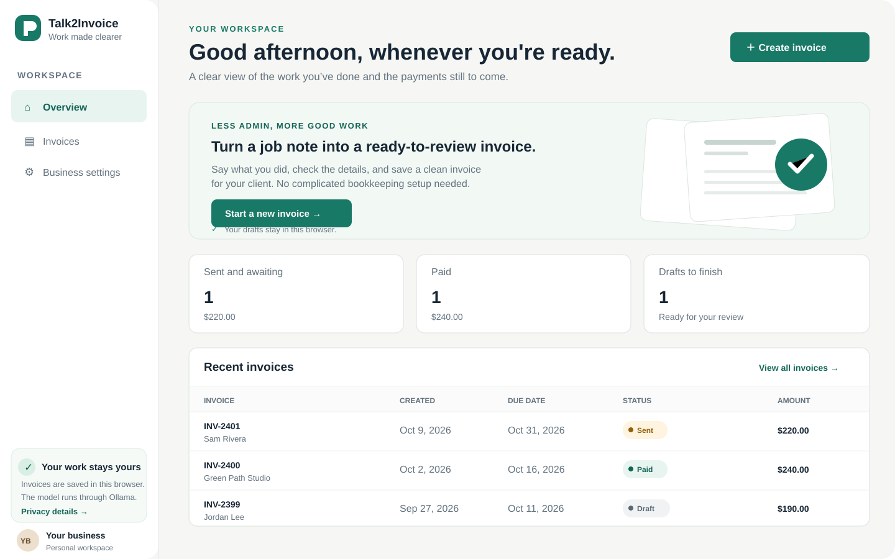
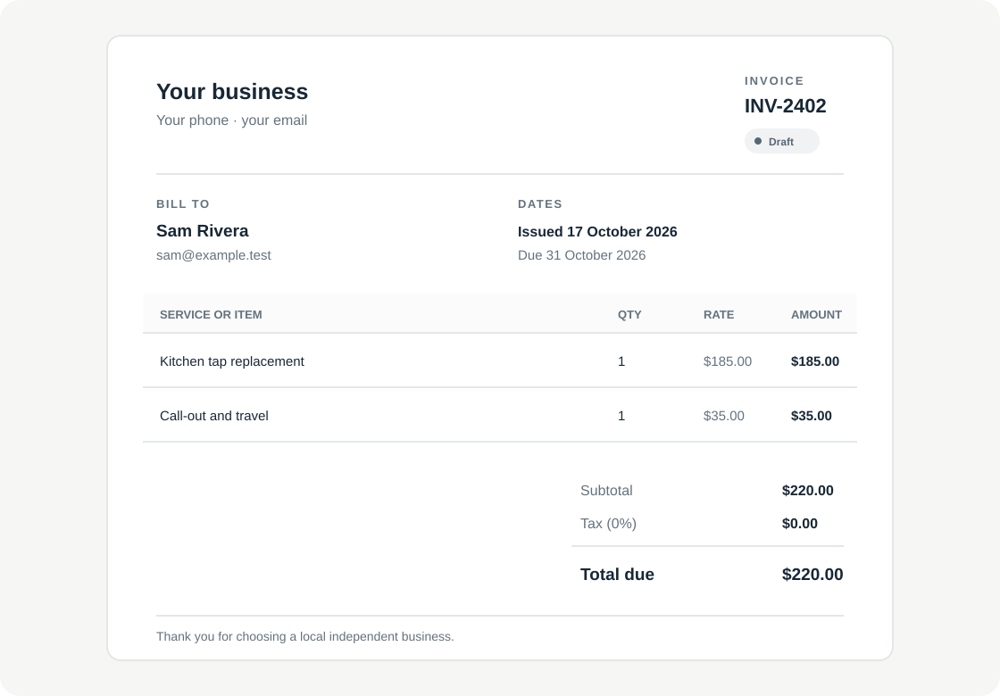
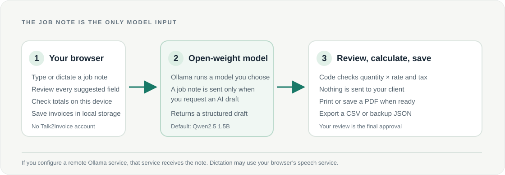

# Talk2Invoice

**Voice-first quote and invoice drafts for independent service workers.**

Talk2Invoice turns a short job note into an editable invoice draft. A plumber can describe a tap replacement. A tutor can dictate a lesson package. A freelancer can type a few lines after a client call. The open-weight model suggests the fields; the person reviews the details and approves the final invoice.



The initial workspace contains clearly labeled fictional examples so the dashboard is useful before you enter business data. The invoice view is designed for printing or saving as a PDF.



## Why this approach

- **A smaller workflow than bookkeeping:** turn a job description into a client-ready draft, without building an accounting platform.
- **Model choice stays open:** an Ollama model drafts client and line-item fields from one note. The recommended starting point is Qwen2.5 1.5B; Ollama lists its quantized model at about 986 MB and documents multilingual support. See the [Ollama model card](https://ollama.com/library/qwen2.5:1.5b).
- **Review stays with the person:** missing rates stay blank, math is calculated in code, and the user checks every suggested name, date, quantity, rate, and total.
- **Local-first storage:** business settings and saved invoices remain in browser storage. The job note is sent only when the user asks the configured Ollama service to draft.
- **No platform account or API key:** run the app and model on a machine you control.



## Run locally

You need Node.js 20 or newer. For AI drafting, install [Ollama](https://ollama.com/download), start its service, and download a model:

```powershell
ollama pull qwen2.5:1.5b
npm start
```

Open [http://localhost:3000](http://localhost:3000). The app remains useful if Ollama is unavailable: you can create a draft manually, use the sample flow, save invoices, print a PDF, and export backups.

To use a different Ollama model or endpoint, copy `.env.example` to `.env` and set `OLLAMA_MODEL` and `OLLAMA_BASE_URL` before starting the server. If you point at a remote model service, that service receives the job note. Do not enter confidential client details unless you trust the service.

### Voice input

The **Dictate** button uses the browser's speech recognition feature when available. Browser speech recognition may use the browser vendor's service, so it is optional. Typing the note avoids that speech service. Talk2Invoice itself does not record or upload audio.

## Run the complete stack with Docker

Docker Compose starts Talk2Invoice and Ollama, downloads the suggested open-weight model once, and saves model files in a named volume.

```bash
docker compose up --build
```

Open [http://localhost:3000](http://localhost:3000). The first run downloads the model and needs an internet connection. Later runs reuse the model volume. The browser app is exposed only on the local machine by default.

To stop the services:

```bash
docker compose down
```

To also delete the downloaded model:

```bash
docker compose down --volumes
```

## Tests

```bash
npm test
```

The tests cover currency rounding, tax math, missing information, model-output normalization, static serving, request validation, and the Ollama API contract. The API contract tests use a local mock server; they do not measure the accuracy, speed, or output quality of a real model. Run the UI with Ollama and review sample inputs on your hardware before relying on it for invoices.

## Deploying beyond one machine

The current version is designed for one person on a trusted machine. It has no login, server-side database, email sender, or payment processor. Browser storage belongs to that browser profile, so export a backup before switching devices or clearing browser data.

You can deploy the Node service as a container by setting `HOST=0.0.0.0`, `PORT`, `OLLAMA_BASE_URL`, and `OLLAMA_MODEL`. Provide a private or access-controlled Ollama endpoint. The app does not include user authentication; do not expose it publicly to multiple users as-is.

## What is included

- A responsive, keyboard-accessible dashboard with readable labels and large controls.
- A job-note composer, optional browser dictation, and a model-drafted invoice form.
- Editable client, invoice date, due date, currency, tax rate, line items, and notes.
- 16 currency choices and seven AI draft languages: English, Hindi, Bengali, Spanish, French, Portuguese, and Arabic.
- On-device arithmetic, invoice preview, print-to-PDF layout, and sent/paid status tracking.
- Local invoice storage, search, JSON backup, and CSV export.
- A service worker for caching the app shell after the first visit.

## Known limits

- No email sending, payment collection, accounting or tax filing.
- Tax calculations are arithmetic only; they are not tax advice.
- AI output is a suggestion, not a verified financial record. Review all details before sharing.
- Dictation support varies by browser and may use a third-party speech service.
- The interface is currently in English; draft-language choices do not yet localize every control or market-specific tax rule.
- Local inference still uses device memory and power. We have not measured the model's cost or performance against a hosted option.
- No external user test or willingness-to-pay validation has been completed yet.

## Challenge entry

This project is prepared for the [Hacktoberfest Open-Source AI Challenge: Week 2 — Side Hustle](https://dev.to/challenges/hacktoberfest-week2-2026-10-12). The challenge asks builders to make a new project with open-source AI at its core and explain who would pay for it. The DEV post draft is in [`submission/DEV-post.md`](submission/DEV-post.md).

## License

MIT. See [LICENSE](LICENSE).
